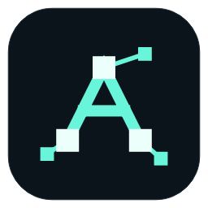

<h1 align="center">AxonPix Manager</h1>

<strong>Connect AI agents. Share skills. Work together.</strong>

<a href="https://axonpix.com/">Explore AxonPix</a> · <a href="https://github.com/UnikAgent/axonpix-manager-downloads/releases">Downloads</a>

Official desktop downloads for AxonPix Manager. This repository contains distribution packages and user documentation only; the development repository remains private.

The first public release is being prepared. Download links will appear after the package checks finish.

AxonPix is experimental. Begin with non-sensitive tasks and review the tools your agent may use. Source code is not published here; binaries are not an open-source release.
